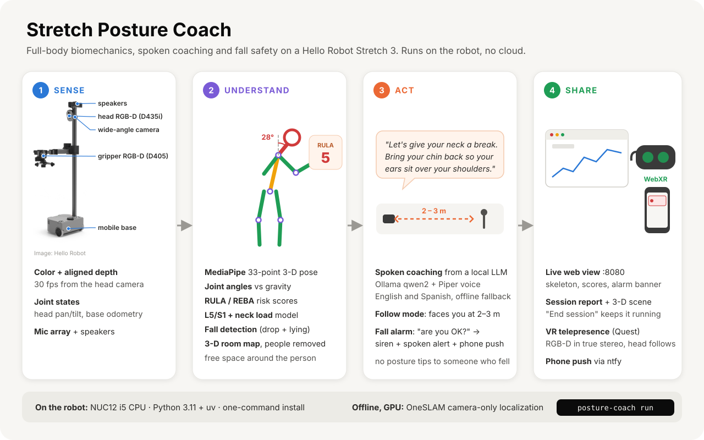
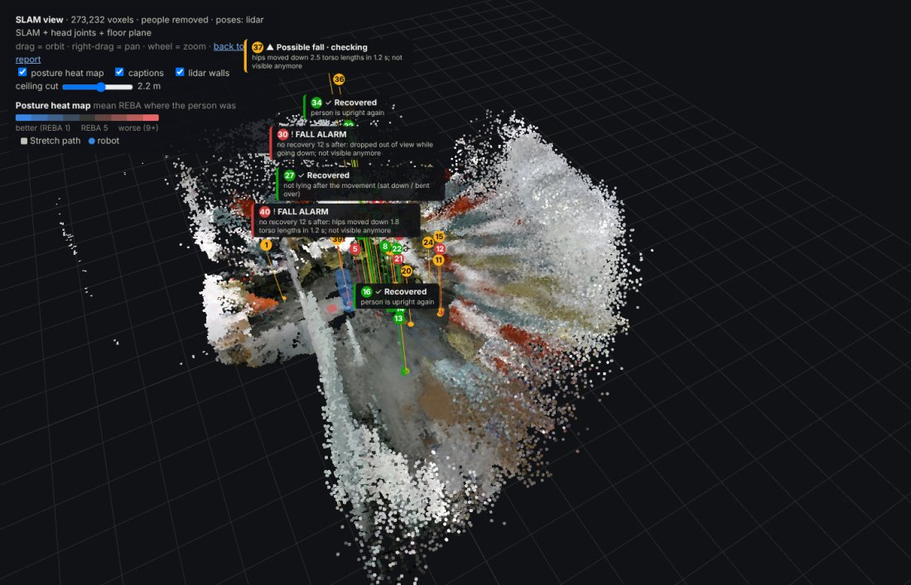
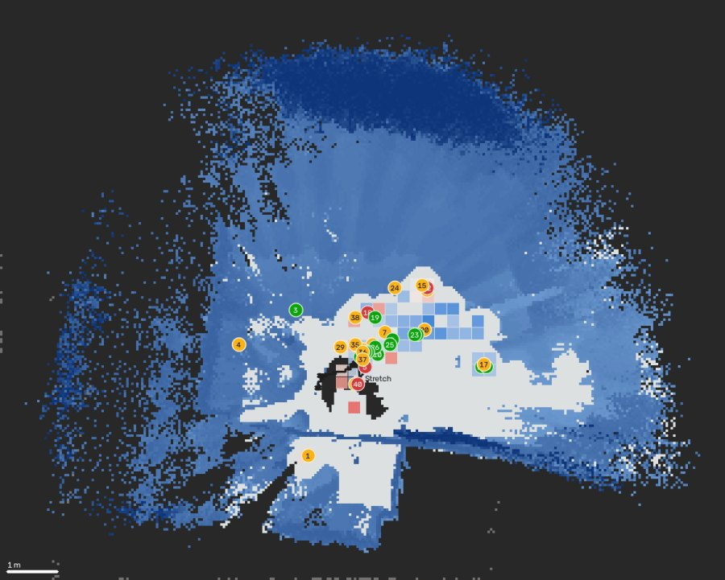
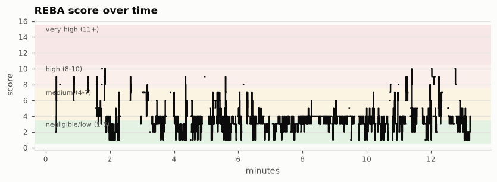
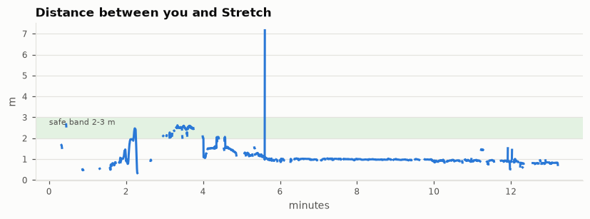
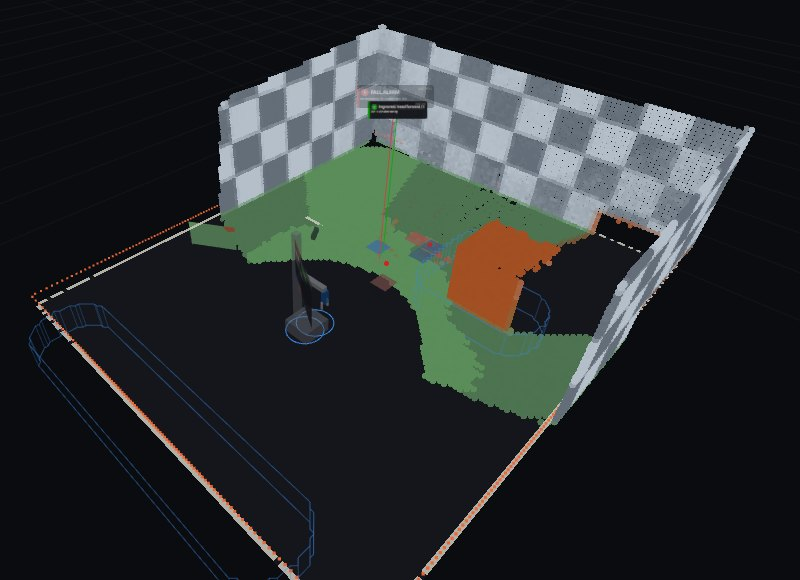
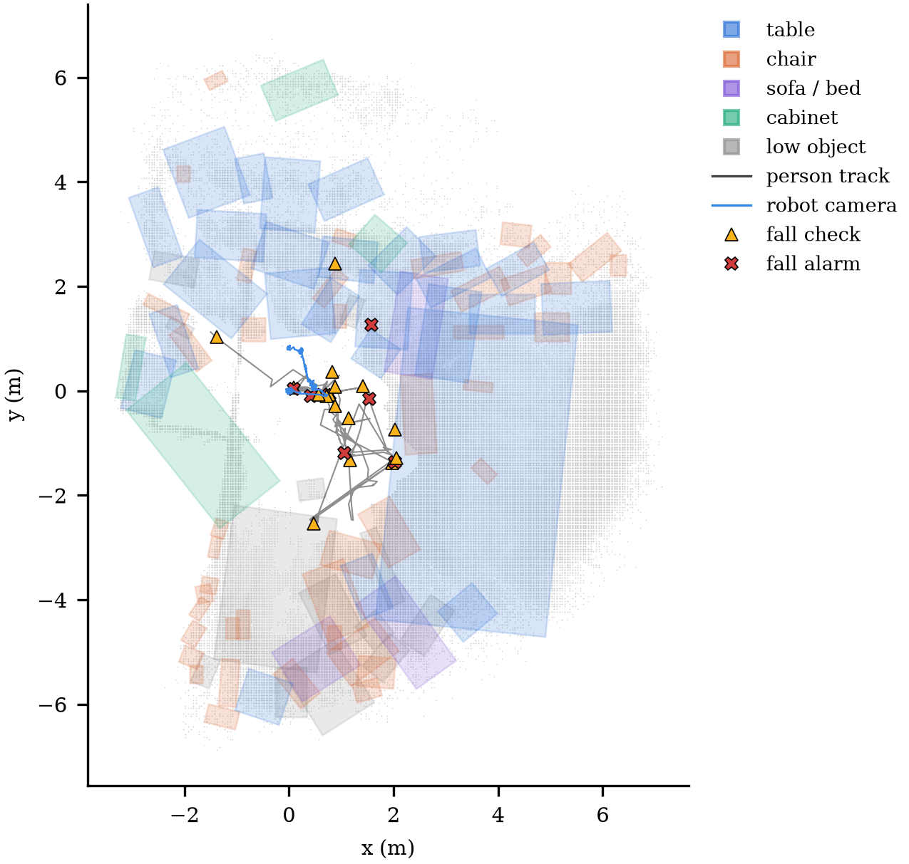

# stretch-posture-coach



Full-body biomechanical posture analysis with **MediaPipe Pose** on a **Hello Robot Stretch 3**. Stretch
watches you with its head camera, estimates joint angles, **RULA / REBA** ergonomic risk and spinal loads
(L5/S1 compression, neck load). When a bad posture lasts too long, it **tells you out loud** how to fix it,
using a local LLM (**Ollama + qwen2**) and an offline neural voice (Piper, with espeak-ng as fallback).

Everything runs on the robot (NUC12 i5-1240P). No cloud.

```
 D435i head camera ──► MediaPipe Pose Landmarker (33 3-D landmarks, ~25 FPS)
                              │
             gravity from head tilt (stretch_body)
                              ▼
        biomech.py   joint angles · L5/S1 & neck load model
        ergonomics.py RULA + REBA (worse side)
        assessment.py smoothing · static-posture timer · sustained-issue rules
                              │
          ┌───────────────────┼──────────────────────────┐
          ▼                   ▼                          ▼
   coach.py ──► Ollama qwen2 ──► Piper TTS ──► Stretch speaker
   head tracking (pan/tilt keeps you centered)
   web viewer :8080 · CSV/JSONL session log · HTML report
```

## Example: a real session

A 14-minute session on Stretch 3 `stretch-se3-3075` (17 Nov 2026), with fall tests and a few minutes of expert
control from a Meta Quest 3S. These images have people removed; nothing here shows a camera frame of a person.

**Start-of-session survey** ([`survey.json`](docs/examples/survey.json)): passed in **48 s**.
* 10 head positions and a **360° base spin**.
* **379 lidar scans matched, 0 rejected** (match score 0.69).
* 76 floor-plane fits. The camera was already well calibrated: tilt offset **+0.18°**, roll 0.06°, height −1 cm.

**Mode timeline** from `events.jsonl`:
1. autonomous → **survey** at the session start.
2. A fall test interrupted the sweep: survey → **fall response**.
3. The survey resumed afterwards and finished: → **autonomous**.
4. Three more fall checks went to fall response and back.
5. The expert took control (→ **teleop**) and later released it (→ autonomous).

| | |
|---|---|
|  |  |
| **SLAM view** (`/sessions/<id>/scene3d`): 273k voxels registered with lidar SLAM + head joints + floor plane, a classroom with rows of desks. Pins are fall checks (amber), alarms (red) and recoveries (green); overlapping labels shrink to their number. | **Top-down map**: free floor (light), furniture by height (blue), the posture heat map (49 cells of 25 cm), numbered captions. The person walked 35 m and stayed ~0.75 m from furniture on average. |
|  |  |
| **REBA** while in view: 53 % negligible/low, 44 % medium, 2.6 % high. | **Distance to Stretch**: follow mode backed off toward the 2–3 m band (min 1–3). The expert had control from min 3 to 13 (follow paused) and drove it to about 1 m. |



*Simulator:* the **control-barrier keep-out lines** around everything the lidar sees (blue = clear), the robot's
footprint circles, the lidar scan (orange dots), the room scan and two captions.

**Talking through Stretch.** These are transcripts from this session. A small LLM often *answered the specialist*
instead of relaying, so clear commands are now rewritten by rules, and replies that talk back are rejected:

| The expert said (speech-to-text) | Before (LLM) | Now |
|---|---|---|
| "Ask the patient to stand up." | "Stand up and try to feel your posture, then stand up again…" | "Please stand up." |
| "Hello, Stretch. Can you tell the patient to stand up?" | "Hello, Stretch. Yes, I can help the patient stand up." | "Please stand up." |
| "Asked the patient how has he been doing lately?" | "Hello! How have you been feeling lately?" | "How have you been doing lately?" |
| "Pass the trap." | "Thanks for the instruction, specialist. I'll make sure to pass the trap." | rejected → says "Pass the trap." |

## Install (one command)

On the robot (`hello-robot@stretch-se3-XXXX`):

```bash
cd ~/Projects && git clone <YOUR-REPO-URL> stretch-posture-coach && cd stretch-posture-coach && ./install.sh
```

`install.sh` is idempotent and does everything:

1. apt: `espeak-ng pulseaudio-utils alsa-utils libportaudio2` (asks for sudo once)
2. installs **uv** if missing, then `uv sync` (Python 3.11 in an isolated `.venv`; the robot's own Python is untouched)
3. puts a `posture-coach` command in `~/.local/bin` that works from any folder
4. downloads MediaPipe pose models (lite/full/heavy) and the Piper voice
5. creates `config.yaml`
6. installs **Ollama**, starts it, and pulls **qwen2:1.5b**
7. runs `posture-coach check` (camera, model, LLM, speaker, head) and Stretch says hello

Options: `./install.sh --model qwen2:7b`, `--spanish` (Spanish voice and coaching), `--norteno` (Spanish
"norteño de la sierra" persona + custom Ollama model), `--no-ollama`, `--no-apt`.
**Never run it with `sudo`**: it installs into your user and asks for the password itself when needed.

> **Before running**, free the hardware: if the ROS 2 driver or a RealSense node is running, it holds the
> camera and the head motors. Stop it (Ctrl+C in that terminal) or run `stretch_free_robot_process.py`.

## Use

```bash
posture-coach calibrate        # once per person: sit/stand tall for 8 s -> calibration.json
posture-coach run              # coach me! Ctrl+C to stop -> session report
```

Open **http://stretch-se3-XXXX.local:8080/** (or `http://<robot-ip>:8080/`) on your laptop to see the live
skeleton, angles, RULA/REBA and what Stretch said. Over SSH no window opens; the web viewer replaces it.

Useful flags:

| Flag | Meaning |
|---|---|
| `--mass 80` | your body mass in kg (load model) |
| `--language Spanish` | Stretch coaches in Spanish (use `./install.sh --spanish` for the Spanish voice) |
| `--model qwen2:7b --host http://<laptop-ip>:11434` | use a bigger model on your laptop's Ollama |
| `--no-llm` | rule-based messages only (no Ollama) |
| `--no-voice` | print messages instead of speaking |
| `--no-robot` | don't move the head |
| `--source webcam:6` / `--source video.mp4` | other camera, or analyze a recorded video |
| `--calibrate` | calibrate first, then run |
| `-s section.key=value` | override any setting in `config.yaml`, e.g. `-s thresholds.neck_flexion=15` |

Other commands: `posture-coach check`, `posture-coach say "hello"`, `posture-coach report [sessions/<stamp>]`,
`posture-coach download-models --voice es_MX-claude-high`, `posture-coach init-config`.

## Follow mode: face me and keep 2-3 m

```bash
posture-coach follow                 # only orientation + distance (no posture coaching)
posture-coach run --follow           # posture coaching + follow
posture-coach follow --target 2.2    # preferred distance
```

Stretch keeps tracking you with its head. When you are more than 12° off-center, the **base turns** toward
you (in steps of at most 20°) while the head counter-turns, so the camera never loses you. Distance comes from
the D435i **depth image** (median over your torso):

| You are... | Stretch... |
|---|---|
| 2.0-3.0 m away | stays put |
| farther than 3.0 m | steps closer (≤ 15 cm per step), never closer than 2.0 m, only when facing you |
| closer than 2.0 m | backs up (≤ 15 cm per step); says it's making room |
| closer than 1.2 m | backs up a full step right away |
| out of view / runstop pressed | freezes |

Safety limits (all in `config.yaml → follow`): it moves only with small, bounded relative steps (never
open-ended velocity commands, and the robot-side helper clamps them again), one step at a time. It needs 6
stable detections first, backs up at most 1 m in total (**Stretch has no rear sensor**) until it drives
forward again, and stays within 3 m of where it started.

Check the hardware first with `posture-coach follow-test`. It opens the robot in base mode, asks before a
tiny test move (10° turn, 5 cm drive, measured with odometry), then shows for 20 s what follow *would* do
(distance, bearing, decision) while you walk around, without moving the base.

**Before the first run:** clear the floor around the robot, keep the **runstop** (the button on the head)
within reach, and make sure no ROS driver is running. Check that `forward_pan_rad: 0.0` really is "head looking
straight over the front of the base" on your robot; if the body turns the wrong way, that value or
`robot.pan_sign` is off. Start with `posture-coach follow`, walk slowly, and watch the distance in the web
viewer.

## En español / norteño de la sierra

```bash
posture-coach norteno-setup                 # once: custom Ollama model "stretch-norteno" + Mexican voice
posture-coach run --norteno                 # coaching in norteño serrano
posture-coach run --norteno --follow        # ...and follow you around
posture-coach run --language Spanish        # neutral Mexican Spanish instead
```

`norteno-setup` writes `personas/stretch-norteno.Modelfile` (base `qwen2:1.5b`, the persona's system prompt,
examples and a slightly higher temperature) and runs `ollama create stretch-norteno`. The persona is a warm,
joking compa from the Sierra of Sonora/Chihuahua ("¡Ah, caray, andas jorobado como vaquero viejo! Recárgate en
la silla y estira esa espalda bien derechito"). It never uses profanity or narco/alcohol references. The
offline fallback lines are norteño too, and so is the voice (Piper `es_MX-claude-high`).

The 1.5B model's Spanish is just OK. For a much richer accent and better jokes use a 7B base. It takes ~4.4 GB
and replies in ~5-10 s on the NUC, which is fine because coaching is asynchronous:
`posture-coach norteno-setup --base qwen2:7b`. You can also run that on your laptop's Ollama and point the
robot at it with `--host`.

To make it permanent, set it in `config.yaml`: `coach.persona: norteno`, `coach.language: Spanish`,
`llm.model: stretch-norteno`, `speech.piper_voice: es_MX-claude-high`.

## Fall detection and alarm

Always on during `run` / `follow` (`fall.enabled`). A fall needs **two things**: a rapid descent (hips drop
≥ 0.45 m within 1.2 s on the depth camera, or ≥ 1 torso length in the image when there is no depth, or the
person vanishes from view while going down), **and** ending up lying (trunk ≥ 55° from vertical, hips low).
Sitting down fast or bending over to pick something up does not count. Lying on the floor (hips < 0.45 m)
for 30 s without a seen fall also counts. Lying on a bed or couch doesn't.

1. **Check:** Stretch asks out loud: *"Are you OK? If you're OK, stand up or raise your hand."* The live page
   and the VR view show an orange banner. If ntfy is configured, a **"possible fall" push (high priority)** goes
   to your phone right away. Base motion pauses.
2. **Recovery** cancels it: standing/sitting upright for 3 s, a raised hand held 1.5 s, or the
   **"I'm OK / acknowledge"** button on the web page, the VR page, or the **grip** button in the headset.
3. **No posture tips while someone is down.** Stretch never gives posture corrections to someone lying down,
   during a fall check or alarm, or for 30 s after it clears (`fall.quiet_after_s`). A tip the AI was already
   writing when the fall happened is dropped. Only the "are you OK?" check and the alarm speak.
4. **Alarm** after 12 s with no recovery: a loud two-tone **siren** plus a spoken alert through the robot
   speaker (repeating), a flashing red banner with a **snapshot** on the web page and in VR, a
   `fall_*.jpg` snapshot saved in the session folder, and **phone notifications** if configured. It stays on until
   someone acknowledges or the person gets up. Every step is logged and shows up in the session report.

**Phone push (free):** install the **ntfy** app (Android/iOS), subscribe to a hard-to-guess topic name, and set
it in `config.yaml`:

```yaml
alarm:
  ntfy_topic: stretch-casa-7f3k9q      # anyone who knows the name can read it: make it unguessable
  webhook_url: ""                      # or POST JSON to Home Assistant / Slack / Teams / your server
```

Test it any time with **`posture-coach alarm-test`**. It sends a real notification through the same code as the
alarm (`--kind alarm` sends the urgent one, `--siren` also plays the siren). Notifications go over IPv4
(`alarm.force_ipv4`), because the robot's network has broken IPv6. If no topic is configured, the log says so
whenever a fall is detected.

You get up to three pushes: **"possible fall"** (high priority) when Stretch starts asking, **"FALL DETECTED - no
response"** (urgent) if the alarm goes off, and **"fall alert cleared"** when the person is OK again or someone
acknowledges. Tapping a notification opens the robot's live view. Set `alarm.notify_on_check: false` to push
only on the alarm.
In `config.yaml → fall` you can tune `check_s`, `long_lying_s` (0 = off), `drop_m`, `lying_incl_deg` and
`camera.height_m` (head camera height, used for hip height). Set `alarm.siren: false` to keep only the
spoken alert.

> This is a helper, **not a certified medical alert system**. It only sees what the head camera sees, and
> works best when Stretch is following you (`--follow`). Don't rely on it as the only safety measure for
> someone at real risk of falling.

## Scene understanding (and OneSLAM)

Each session also records **RGB-D keyframes** from the head camera (1 per second by default). Each keyframe
stores its **registered camera pose**: lidar SLAM, the head joints and the floor-plane correction. The person's
registered positions and REBA scores go to `track.jsonl`. The report gets a **Scene understanding** section:

* a top-down map of the room: free floor, obstacles by height, lidar walls, Stretch's path, the **posture heat
  map**, and numbered **captions**
* **"What happened where"**: fall alarms, coaching moments and measured improvements, with time and detail
* the free space around the person, the distance they walked, the floor area they used, and their distance to
  Stretch
* a 3-D **SLAM view** (`/sessions/<id>/scene3d`) and a PLY point-cloud download. The SLAM view shows captions
  pinned in the scene (click one to fly to it), the heat map, lidar walls and a ceiling-cut slider.

People are removed from the static map: masked, carved around their track, and carved wherever later frames see
through them. Sessions recorded before this version are rebuilt with the floor-plane correction.

For **camera-only localization** the same recording can be run through
[OneSLAM](https://github.com/arcadelab/OneSLAM) on a machine with an NVIDIA GPU:

```bash
posture-coach scene export-oneslam <session>          # on the robot: OneSLAM input format
./scripts/run_oneslam.sh ./stretch_<session>           # on the GPU machine (pinned OneSLAM commit)
posture-coach scene import-oneslam <session> poses_pred.txt   # back on the robot
```

The import recovers metric scale from the depth camera, converts camera poses to base poses with the head joint
states, and adds validation to the report (including "the base must not move when only the head moves").
`posture-coach scene build <session>` rebuilds the map and report. The full workflow, status against the plan,
and limitations are in **[docs/ONESLAM.md](docs/ONESLAM.md)**, and the plan itself in
[docs/ONESLAM_PLAN.md](docs/ONESLAM_PLAN.md).

Storage is about 350 MB per hour at 1 Hz. Set `scene.record_hz`, `scene.max_frames`, or `scene.record: false` to
change it.

### Scene graph: what the furniture is, and where things happened

The voxel map says *where* things are; the **scene graph** says *what* they are and how the person relates to them.
It is a layered 3-D scene graph (room → objects → person and robot → events), rebuilt from the live map every 5 s
on the robot's CPU (`scenegraph.py`):

* **Objects** are segmented from the registered map without learning: 5 cm columns are binned by their top height
  (low < 0.35 m, seat < 0.66, table < 1.0, tall < 1.6, wall). Connected parts per band become objects; footprints
  that are not one compact piece (desks joined in a row, an L-shape) are split by erosion and regrown; a chair's
  backrest at table height is merged back into its seat. Labels: table, chair, sofa, bed, cabinet, low object, wall.
  If the MediaPipe object detector is installed (`posture-coach download-models`), its COCO detections are
  back-projected with depth and vote on the labels.
* **Relations**: `in`, `next_to`, `at` (chair at table), `sitting_on` / `lying_on` / `on` (the furniture under the
  hips, checked against the hip height), `near`, `occluded_by` (furniture between the camera and the person),
  `sees` (robot → person), and `at` for every event.

What uses it:

| | Without the graph | With the graph |
| --- | --- | --- |
| Coaching prompt | "user is sitting; neck flexed 28°" | + "The person is sitting on chair 3 at table 1." (the LLM can suggest raising the screen) |
| Fall check | "dropped out of view while going down" | + "(near table 6, hidden behind table 6)" in the spoken log, the phone push and the caption |
| Lying for 30 s | floor check fires on a sofa or bed too | only fires when the hips are over the floor |
| Captions / report | position only | "near table 6"; posture (REBA) per object; fall checks per object |
| VR | voxels | labelled furniture boxes; the one the person uses is highlighted; HUD line with the relation |

`posture-coach scene-graph <session>` builds `scene/scene_graph.json` for a recorded session; the report and the
3-D SLAM view show it. On synthetic furnished rooms with ground truth (`scripts/eval_scenegraph.py`), the
segmentation finds and labels 100 % of 481 objects even with 2 cm noise, 40 % dropout and chairs touching the
desks; on the real classroom session (no ground truth) it finds 26 tables and 42 chairs, places all 16 fall checks
within 1 m of a segmented object (10 at tables), and shows the person's mean REBA at each desk.



## Session report on the web

**End session & save report** (button on the live page `:8080`, and on the VR page): closes the current session,
builds its report in the background, and immediately starts a new session. Camera, robot, coaching, fall
detection, follow mode and the web/VR services **keep running**. A green notice links to the saved report.
Use it to split a day into sessions (e.g. one per task or per person) without restarting anything.

When you stop the program (Ctrl+C), the report is written and **the live page switches to it automatically**:
`http://<robot-ip>:8080/report`. The server stays up until you press Ctrl+C a second time. All past
sessions are listed at `/sessions`. Each report includes time in RULA/REBA risk bands, % time over each limit,
charts (neck/trunk flexion, L5/S1 load, RULA/REBA, distance to Stretch) and a transcript of **what Stretch
said and why**. To browse reports later without starting a session, run `posture-coach serve`.

## Modes, the 360° survey and control barrier functions

**Who is in charge** is a small state machine (`modes.py`). Each state owns the head, base, arm and coaching:

| Mode | Head | Base | Arm | Coaching |
|---|---|---|---|---|
| **SURVEY** (start of every session) | 360° sweep | survey spin | - | background |
| **AUTONOMOUS** | tracks you / follows the VR headset | follow mode | - | speaks |
| **TELEOP** (expert took control) | expert's headset | expert's joysticks | expert | background |
| **FALL_RESPONSE** | tracks you | stopped | - | off (only the fall check / alarm) |
| **SAFE_STOP** (runstop) | holds | stopped | - | background |

Transitions:
* A new session goes from AUTONOMOUS to SURVEY, then to AUTONOMOUS when the survey finishes.
* Take control goes to TELEOP from any of SURVEY, AUTONOMOUS or FALL_RESPONSE. Releasing it goes back.
* A fall goes to FALL_RESPONSE. During TELEOP the expert stays in charge while the alarm still runs.
* The runstop goes to SAFE_STOP and back.
* If something interrupts a survey, it runs again afterwards.

Every change is logged (`events.jsonl`, kind `mode`) and shown in the VR HUD. To add a new capability, add a
state, its policy and its transitions.

**360° survey: recalibrates at every session start** (including after "End session"):
1. A **new lidar SLAM map** is started (the map frame = where the robot stands now).
2. The **floor-plane correction** of the head camera is measured from scratch.
3. The head **sweeps about 315°** at a floor-seeing tilt (the lidar covers the full 360° on every scan).
4. If the barriers allow it, the base **spins 360°** in 30° steps (`survey.rotate_base: auto | true | false`).
5. The head returns to the front.

It takes about 20–50 s and passes when there are matched lidar scans, a floor fit and enough mapped room.
The result goes to `survey.json` and the log. Disable it with `survey.enabled: false`.

**Control barrier functions** (`cbf.py`). Every lidar return `o` is a barrier
`h = ‖c − o‖² − d²` on two circles covering the base footprint (d = 0.21 m + 0.20 m margin).
* **Velocity commands** (the expert's joysticks) pass a QP filter, `min ‖u − u_ref‖` subject to
  `ḣ ≥ −α·h`, so they are changed as little as possible. The robot slows smoothly and stops at the barrier, and
  turning away or backing off stays free.
* **Position steps** (follow mode, the survey spin) use the discrete-time condition `h⁺ ≥ (1 − γ)·h`.
* People are barriers too: the lidar sees legs.
* **VR shows the keep-out lines (h = 0)** as low fences around what the lidar sees: blue = clear,
  amber = close, red = a barrier is currently limiting the command. The footprint circles are drawn around the
  robot avatar.
* Tune them under `safety:` (`margin_m`, `alpha`).

## VR telepresence (Meta Quest 3/3S browser)

While a session runs (`posture-coach run`, `posture-coach follow`, ...), a second web service streams a
**registered 3-D scan** of the room for VR:

1. Put the Quest on the same Wi-Fi as the robot and open the **Meta Quest Browser**.
2. Go to **`https://<robot-ip>:8443/`**. The robot prints the exact URL at start-up.
3. The first time you'll see "Your connection is not private". Tap **Advanced → Proceed**. The robot uses a
   self-signed certificate because WebXR only works over https.
4. Tap **Enter VR**. **Where you are looking when you enter is Stretch's "front"** (0 rotation). The robot head
   starts looking to the front. From then on it turns by the same amount you turn your head, measured from that
   starting pose (X turns this on/off). The world rides along with the robot, so its front stays in front of you.
5. **Y switches cameras:**
   * **head RealSense D435i** (default): first person from Stretch's head, inside the registered scan;
   * **gripper RealSense D405**: its own live RGB-D 3-D view, as if your eyes were on the gripper;
   * **overview**: behind and above Stretch.

   Hold Y to toggle the overlays (heat map, captions and barrier lines).

### One registered scan (lidar SLAM + depth)

Everything you see sits in **one map frame**, so nothing swims, doubles or stacks:

* **Where the base is:** 2-D **lidar SLAM** using the base RPLidar. Scans are matched against an occupancy grid,
  starting from wheel odometry. In simulation it held 1–2 cm while the wheel odometry alone drifted 60 cm.
* **Where the camera looks:** the head pan/tilt joints.
* **Tilt, roll and height:** measured from the **floor plane** the D435i sees. This removes the head-tilt
  encoder offset, camera roll and camera height error that caused the "stacked floors" and the slanted
  ceiling in older maps.
* **The room:** head RGB-D frames are fused into a persistent colored voxel scan that streams to the headset as
  incremental updates. People are masked out. Voxels the camera later sees *through* are carved away, so people
  and moved furniture leave no ghosts. The ceiling above 2.2 m is hidden by default (it was the gray "cloud").
* **The person** is a live depth surface with a 3-D skeleton colored by risk. Both are placed with the same
  registered camera pose.
* **The floor** shows the lidar scan (orange dots) and the lidar occupancy grid (walls). A **robot avatar** moves
  with the real joint states.
* **Panels:** the gripper **D405** camera, the wide-angle camera and the HUD. The HUD shows RULA/REBA, distance,
  the last message and the SLAM status.
* **Low latency:** the headset acknowledges each message, and stale frames are skipped rather than queued.
  Rendering runs at 72-120 Hz regardless of the Wi-Fi.

Check the lidar mounting once with `posture-coach lidar-test`. Stand about 1 m in front of the robot: the
nearest object should read about 0°. Without a lidar (or with `lidar.enabled: false`), poses fall back to wheel
odometry. The floor correction still applies.

### Captions and the posture heat map

* **Captions** appear in the scene where things happened:
  * fall checks and alarms (red),
  * coaching moments (orange),
  * **measured improvements** (green), such as "Improved: head forward, 32° → 9° after the tip".
  The same captions are numbered in the report's SLAM view and in its top-down map, with a "What happened
  where" table.
* **Heat map:** 25 cm floor cells colored by the mean **REBA** score while the person was there. Blue means better
  posture, gray means REBA 5 and red means worse. It shows *where* in the room posture breaks down, for example
  at a low shelf or one particular chair.
* **Toggle** both with **Y** in VR, or with the checkboxes on the page and in the report's 3-D view. The report's 3-D view
  also has a ceiling-cut slider and a lidar-walls layer.

### Expert teleoperation (overrides follow mode)

An expert can take over the base and the arm from the headset. On the VR page (before entering VR), type the
**PIN** that the robot prints at start-up (`EXPERT TELEOP PIN: ...`) and tap **Take control**. Only one
expert can have control at a time. Five wrong PINs lock the PIN entry for 60 s. Set a fixed PIN with `teleop.pin`.

| Control | Does |
|---|---|
| **Right GRIP (hold)** | clutch: the gripper follows your hand. Up/down = lift, along the arm = extend/retract, turn/tilt/roll = wrist yaw/pitch/roll. Release, move your hand, grip again to "ratchet". |
| **Right trigger** | precision mode (hand motion × 0.3) |
| **A / B** | **open / close the gripper**. The right controller **vibrates with the grip force** (gripper motor effort), with a click on first contact. Lift/arm contact also vibrates. |
| **Right stick click** | wrist following on/off |
| **Left stick** | drive: forward/back, left/right **turns** (Stretch is differential-drive and can't strafe) |
| **Right stick** | also drives, at 40 % for fine moves |
| **Left stick click** | pause/resume control: paused = Stretch's routine comes back to the foreground |
| **X** | robot head follows your head (relative to your starting pose) |
| **Y** | switch camera (head D435i → gripper D405 → overview); hold = overlays |
| **Left trigger (hold)** | **talk through Stretch** (push-to-talk, see below) |
| **Bare hands** | put the controllers down: the **right hand** moves the arm while the **left hand pinches** (clutch), and the right thumb–index distance sets the gripper opening. No joystick or vibration without controllers. |

Taking control switches the robot to the **TELEOP** mode (see *Modes* below). The coaching routine runs **in the
background** during TELEOP: posture is still measured, logged and heat-mapped, but Stretch doesn't speak tips
and follow mode is off. Pausing or releasing control brings the routine back to the foreground.

**Talk through Stretch.** Hold the **left trigger** in VR, or the "Hold to talk" button on the page, and speak.
* The Quest microphone streams to the robot.
* Offline speech-to-text (**faster-whisper**, on the robot's CPU) shows a live transcript in the HUD.
* On release, the **local LLM turns your words into what Stretch says**, in its persona and language.
* Stretch speaks it with **its own voice**.

Set `voice.mode: verbatim` to skip the LLM, and `voice.stt_model: small` for better Spanish. Allow the
microphone when the page asks; tapping "Take control" asks for it. Only the PIN-authenticated expert can talk.

Safety:
* The base stops 0.4 s after the last headset message. The robot helper has its own 0.3 s watchdog.
* Speed is capped at 0.25 m/s (0.3 hard cap) and 0.6 rad/s.
* Every base command passes the **control barrier functions** built from the lidar scan (see below). There is
  also a hard emergency stop 0.12 m from the footprint.
* The runstop is respected, and the arm/lift only move if the robot is **homed** (`stretch_robot_home.py`).

Settings are under `teleop:` in the config, including the gripper effort → vibration mapping and
`arm_axis_sign` in case the arm extends the wrong way.

Teleop needs the whole robot, so `posture-coach run` now opens stretch_body's `Robot` (base, lift, arm, wrist,
gripper) instead of just the head. Don't run the Xbox teleop script at the same time. To keep the old head-only
behavior, set `teleop.enabled: false`.

When the session ends, the headset exits VR and opens the report.

Tuning (`config.yaml → vr`):
* `fps` (15) and `depth_decimation`;
* `map_hz`, `map_voxel_m`, `map_ceiling_m` and `heat_cell_m`;
* `gripper_camera` / `nav_camera` (`auto`, `false`, or `/dev/videoN`).

Turn VR off with `--no-vr`. 5 GHz Wi-Fi is recommended.

### Placement

* Stand or sit **2-3 m** from Stretch with your **whole body** in the frame. Head tracking keeps you centered.
* A **side (profile) view** gives the most accurate neck/trunk flexion; a front view is best for side bend,
  shoulder tilt and twist. A 45° view is a good compromise.
* Run `posture-coach calibrate` in your best neutral posture. Angles are then measured relative to *your*
  neutral, which removes landmark bias (ears vs. shoulders differ between people).

## What it measures

| Metric | How |
|---|---|
| Neck flexion / extension, side bend, twist | ear-midpoint vs shoulder-midpoint, relative to the trunk |
| Trunk flexion, side bend, twist | shoulder-mid vs hip-mid against gravity; shoulder line vs hip line |
| Shoulder tilt / shrug | shoulder height difference; ear-to-shoulder distance vs calibration |
| Upper arm elevation, abduction; elbow, wrist, hip, knee flexion | 3-D segment angles (per side) |
| Posture state | sitting / standing from hip and knee angles |
| **RULA** (1-7) and **REBA** (1-15) | standard tables, worse side, +1 when a posture is held > 60 s |
| **L5/S1** moment, compression, shear | static segment model (Winter/Dempster mass fractions, 5 cm erector arm) + `hand_load_kg` |
| Neck moment / equivalent load | head mass (8.1 % BW) × forward offset of the head |

Gravity is taken from the **head tilt joint**, so angles stay correct when Stretch looks down at you.

Coaching rules (thresholds in `config.yaml → thresholds`) fire only after a violation lasts `hold_s`
(default 6 s), with hysteresis. Stretch waits `min_interval_s` between messages, does not repeat the same
issue within `repeat_interval_s`, praises you when you fix it, and reminds you to take a movement break
every `break_reminder_min`. If Ollama is down or slow, it falls back to built-in messages.

### Outputs

Each run creates `sessions/<timestamp>/`:
`metrics.csv` (5 Hz), `events.jsonl` (everything Stretch said and why), `config.yaml`, `summary.json`, and
`report.html` (time in RULA/REBA risk bands, % time over each limit, charts).

## Configuration

Edit `config.yaml` (only the keys you change matter; the defaults are documented in
`src/stretch_posture_coach/default_config.yaml`). Common tweaks:

```yaml
subject: {body_mass_kg: 78, hand_load_kg: 0, arms_supported: true}
coach:   {language: Spanish, user_name: Ana, min_interval_s: 40}
llm:     {model: qwen2:1.5b, host: http://localhost:11434}
speech:  {piper_voice: es_MX-claude-high, espeak_voice: es-419}
robot:   {head_tracking: true, pan_sign: -1, tilt_sign: -1}
camera:  {rotate: cw90}
```

## Troubleshooting

| Symptom | Fix |
|---|---|
| `No RealSense camera found` / `Could not start` | Something else holds the D435i (ROS 2 driver, realsense node). Stop it or run `stretch_free_robot_process.py`. |
| Snapshot `check_snapshot.jpg` is upside-down/sideways | `camera.rotate: ccw90` (or `none`, `180`). |
| Head turns **away** from you | flip `robot.pan_sign` (or `tilt_sign`) to `+1`. |
| `head.startup() failed` | the ROS driver is using the motors; free the robot (see above), or run with `--no-robot`. |
| No sound over SSH | `posture-coach say "test"`. The app sets `XDG_RUNTIME_DIR` for you; also check the volume with `pactl list sinks short` / `alsamixer`, and that a desktop session is logged in. |
| Follow: the base never moves | Follow is **off by default**: use `posture-coach follow` or `run --follow` (or `follow.enabled: true` in config.yaml). The log prints `follow: <decision> <reason>` on every change. It also pauses while someone controls the head from VR (press X in the headset), while an expert has teleop control, and when the runstop is pressed. Run `posture-coach follow-test` to check base access, do a tiny test move, and dry-run the camera. |
| Follow: base turns the wrong way / away from you | check `follow.forward_pan_rad` and `robot.pan_sign`; press the runstop first |
| Follow: "Follow mode requested but the mobile base is not available" | the ROS driver holds the robot (`stretch_free_robot_process.py`), or `stretch_body` failed to start; see the log |
| apt/Ollama hang on "Connecting to ..." an IPv6 address | `sudo sysctl -w net.ipv6.conf.all.disable_ipv6=1` (until reboot), then for snap Ollama `sudo snap restart ollama` |
| Fall alarm goes off when lying down on purpose (exercise on the floor) | raise a hand or press "I'm OK" during the check; or raise `fall.long_lying_s` / set it to 0 |
| No phone notification | set `alarm.ntfy_topic` and subscribe to the same topic in the ntfy app; the robot needs internet access to reach ntfy.sh |
| Quest: "Enter VR" greyed out | open the page with **https://**…:8443 (not http) and accept the certificate warning |
| Quest: VR view is black / "connected - waiting for video" | a session must be running (`posture-coach run`); check the robot log for "VR viewer connected" |
| VR scan looks doubled / floors stacked | check the SLAM status in the HUD (`lidar SLAM <score>`). With `no lidar: odometry`, run `posture-coach lidar-test`. If the lidar works but the walls are mirrored or rotated, set `lidar.yaw_offset_deg` / `lidar.clockwise`. The floor correction needs the floor in view at least once (tilt the head down). |
| VR: wide-angle camera panel is sideways | set `vr.nav_rotate` (cw90/ccw90/180); disable with `vr.nav_camera: false` |
| Teleop: "wrong PIN" / nothing moves | the PIN changes every run unless `teleop.pin` is set (see the log line `EXPERT TELEOP PIN`). The HUD shows notes such as `arm not homed` (run `stretch_robot_home.py`), `runstop pressed`, or `obstacle 0.25 m ahead: stopped` (lidar guard). |
| VR: the robot head turns the wrong way when I turn | set `vr.look_yaw_sign: -1` (or `look_pitch_sign`). "Front" is `follow.forward_pan_rad` / `robot.front_tilt_rad`. Re-enter VR to reset the zero. |
| Push-to-talk: "speech-to-text failed" | run `posture-coach download-models` once (downloads the whisper model); allow the microphone in the Quest browser |
| Survey FAILED in the log | read `survey.json`: `floor` = the head never saw the floor (lower `survey.tilt_rad`), `lidar` = check `lidar-test`, `map` = too dark / no depth |
| Base won't move closer to something | that's a control barrier (red line in VR). Lower `safety.margin_m` with care. |
| Teleop: arm extends when I pull my hand back | set `teleop.arm_axis_sign: 1` |
| Teleop: gripper vibrates all the time / never | adjust `teleop.gripper_effort_free` / `gripper_effort_full` (gripper motor effort in %); the grip-force bar in the HUD shows the current level |
| Messages are slow | Normal first time (model load). Use `qwen2:0.5b`, or run Ollama on your laptop: `--host http://<laptop-ip>:11434`. On the laptop, start it with `OLLAMA_HOST=0.0.0.0 ollama serve`. |
| Angles look off | calibrate; prefer a side view; make sure your whole body is visible. |

## Limitations

This is an **ergonomic coaching tool, not a clinical instrument**. Monocular pose is noisy in depth
(especially wrist and twist angles), RULA/REBA force, coupling and wrist-twist inputs are assumed from
config, and the load model is a static 3-D approximation (no dynamics, no muscle co-contraction).

## Development

```bash
uv sync
uv run pytest            # 93 tests: geometry, RULA/REBA, load model, follow, fall detection/alarm, personas, web, VR, end-to-end
uv run ruff check .
```

Layout: `src/stretch_posture_coach/` contains `camera.py`, `pose.py`, `biomech.py`, `ergonomics.py`,
`assessment.py`, `coach.py`, `personas.py`, `follow.py`, `llm.py`, `speech.py`, `robot.py` + `robot_helper.py`, `visualize.py`,
`stream.py`, `web.py`, `vr.py` + `web/vr.html`/`vr.js` (three.js r187 vendored), `certs.py`, `fall.py`, `alarm.py`, `scene.py` + `web/scene3d.html`, `logger.py`, `report.py`,
`pipeline.py` and `cli.py`.

`robot_helper.py` (head only, or the whole robot with `--base` in follow mode) runs on the robot's **system** Python (`/usr/bin/python3`, which has Hello Robot's
`stretch_body`) as a small subprocess, so the uv environment never conflicts with the robot's packages.
